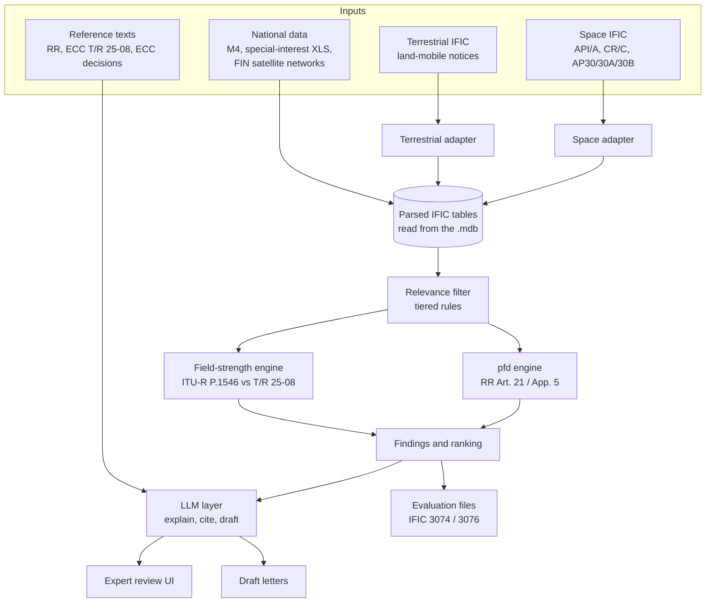

# IFIC Guard — Architecture

AI-assisted, auditable workflow that monitors ITU BR IFIC publications, identifies items relevant to Finland, runs deterministic interference calculations, and prepares expert-reviewable draft correspondence.

Built for the Traficom challenge at the Since AI Hackathon 2026 (Turku, 6–8 Nov 2026).

---

## 1. Goals

| Goal | How the architecture meets it | Criterion |
|---|---|---|
| Technically credible, reproducible analysis | All filtering and calculations are deterministic code with visible inputs, assumptions and parameters | A (25%) |
| One architecture for space and terrestrial | Shared core; each domain is an adapter plus an engine | B (25%) |
| Useful, prioritised output | Computed severity score, ranked findings list, expert review UI | C (20%) |
| Accurate case recognition | Tiered relevance filter driven by Finnish national data (M4, special-interest stations, FIN satellites) | D (15%) |
| Auditability | Every finding links to the source notice, the source file hash, the M4 table page and the regulation clause | E (15%) |

## 2. Design principles

1. **The LLM never decides relevance and never computes numbers.** It explains finished findings and drafts letters, using only retrieved text.
2. **The unit of analysis is the frequency assignment**, not the notice. One network has many groups with different frequencies, powers and beams.
3. **Source IDs are kept verbatim** (ITU `ntc_id`, group ID, terrestrial notice ID) together with the raw source row.
4. **Limits are data, not code.** Article 21 masks, Appendix 5 thresholds and T/R 25-08 triggers live in a table with a citation per row.
5. **Units are in column and variable names** (`f_low_mhz`, `p_dens_max_dbw_hz`, `gain_max_dbi`).
6. **Conservative screening.** Where data is missing, use worst-case assumptions and state them. The tool may over-flag but should not miss cases.
7. **Every IFIC issue is loaded as a new source**, never overwriting the previous one, so diffs and trends come for free.

## 3. Pipeline overview



Deterministic components: adapters, store, filter, engines, ranking. LLM-assisted: explanation and drafting only.

Automatic IFIC updates, email notifications and the FastAPI services around this pipeline are described in [docs/services-architecture.md](docs/services-architecture.md).

## 4. Components

### 4.1 Domain adapters

Common interface, one implementation per domain:

```python
class DomainAdapter:
    def ingest(self, issue) -> list[Notice]: ...
    def diff(self, prev, curr) -> list[Change]: ...        # new / modified / withdrawn
    def candidates(self, notices, national) -> list[Candidate]: ...
```

**Space adapter**
- Input: Space IFIC databases (MS Access, SNS format; the SRS comes in several linked parts).
- Read with `mdbtools` or `pyodbc`; map tables using Section III of the Space Preface.
- Sections in scope: API/A, CR/C, AP30, AP30A, AP30B.
- Extracts per group: frequency range, direction, service, power density, beam gain, GSO longitude or NGSO orbital elements, provisions (9.7, 9.14 …) and affected administrations.

**Terrestrial adapter**
- Input: Terrestrial IFIC, converted from MS Access to SQLite with the ITU BR IFIC format converter.
- Scope: land-mobile notices only.
- Diffs consecutive issues to classify notices as new, modified or withdrawn.
- Extracts: frequency, station class, coordinates, power (ERP/EIRP as notified), antenna height, azimuth, effective height.

### 4.2 Normalised store

**Deferred.** The design was a DuckDB file with the DDL in `schema.sql`. It isn't connected: the adapters read the `.mdb` directly for each screening run, and operational data (issues, cases, events, notifications) lives in Postgres, or SQLite for local work. Reading the source each time was fast enough for one issue at a time (about 45 seconds for Space 3074 with the pfd rule) and needs no second copy of the data. Cross-issue analysis, such as trends over many issues, would be the reason to revisit this. `schema.sql` stays as the design for it.

| Group | Tables |
|---|---|
| Provenance | `source_file` (kind, IFIC number, date, SHA-256) |
| Shared core | `notice`, `assignment` |
| Domain detail | `space_orbit`, `beam`, `terr_station` |
| Change tracking | `notice_change` |
| National reference | `m4_allocation`, `protected_station`, `fin_satellite_band` |
| Limits | `limit_mask` (breakpoints, reference bandwidth, citation) |
| Output | `finding` |

### 4.3 National reference data

| Source | Loaded into | Notes |
|---|---|---|
| Regulation M4 (4 AG/2026M, in force 31.3.2026) | `m4_allocation` | Parsed from the PDF by `parse_m4.py`; 1,387 rows; each row keeps its table page for citations |
| M4 band summary | `m4_satellite_filter.csv` | 212 bands from 30 MHz up, with space/terrestrial/passive flags and a concern level |
| Special-interest XLS (SinceAI platform) | `protected_station` | Station number, frequency, coordinates, antenna data |
| Finnish satellite networks | `fin_satellite_band` | All `adm = 'FIN'` networks in the SRS |
| M15 (licence-exempt) | optional | Low-severity notes only |

### 4.4 Relevance filter

Tiered, cheapest first. Each rule that fires is recorded in `finding.trigger_rules`.

| Tier | Rule | Effect |
|---|---|---|
| 1 | FIN listed as affected administration in CR/C | Always included |
| 2 | Frequency overlap or small-gap adjacency with an M4 primary allocation, a special-interest station, or a FIN satellite band | Candidate |
| 3 | Geometry: GSO visible from Finland (roughly 47°W–97°E); NGSO inclination ≥ ~55°; terrestrial station within a band-dependent distance of the border | Candidate passes to an engine |
| — | Passive / radio astronomy band (e.g. 1400–1427 MHz, all emissions prohibited) | High priority regardless of power |

Key national cases from M4:
- **3.4–3.8 GHz** is MOBILE AND FIXED (5G) with no space-to-Earth allocation in Finland; FSS downlink starts at 3.8 GHz.
- **17.7–19.7 GHz** has dense fixed radio links shared with FSS downlink.
- **8.025–8.4 GHz** has fixed radio links and a newly primary EESS downlink.
- **10.7–12.75 GHz** has no terrestrial use in Finland; 10.70–10.95 and 11.20–11.45 GHz are "not in use in Finland, but reserved".

### 4.5 pfd engine (space)

GSO calculation, implemented in `engines/pfd.py`:

```
cos ψ = cos φ · cos(λs − λ)
d     = √(Re² + Rs² − 2·Re·Rs·cos ψ)          Re = 6378 km, Rs = 42 164 km
δ     = atan((cos ψ − Re/Rs) / sin ψ)          angle of arrival (elevation)
pfd   = P_density + 10·log10(B_ref) + G − 10·log10(4π·d²)     [dB(W/m²) per B_ref]
margin = pfd − limit(δ)                        positive = exceeds
```

- Free-space propagation only (RR Article 21 limits are defined that way); no atmospheric losses.
- Limits from `limit_mask`, piecewise in δ (typically 0–5°, 5–25°, 25–90°).
- Two separate tests, labelled in the output:
  - **Article 21 limits** — compliance; exceeding means a non-compliant filing.
  - **Appendix 5 thresholds** — coordination trigger under RR No. 9.14.
- Evaluated on a ~0.5° grid over Finland plus the special-interest stations; the worst point is reported.
- Northern Finland sees GSO satellites at low elevation and therefore the strictest part of the mask; the grid captures this.

**NGSO**, implemented in `engines/pfd_ngso.py`. Each calculation gives two results of different kinds, kept apart in the output:

- **Upper-bound envelope.** For each arrival angle, it takes the shortest distance the notified perigee, apogee and inclination allow, for any node, phase, epoch or argument of perigee, and keeps the largest margin against the mask. It may describe a state the satellite never occupies, so a bound above the limit is `envelope_exceeds`, and is never reported as exceeding.
- **One-day flight.** Two-body propagation with no J2, in one-minute steps over 24 hours, from the notified elements of one satellite per distinct orbit shape, tested at 90 Finnish points. It can miss the worst case. A positive margin here is the only non-GSO result reported as `exceeds`.

For a notified orbit, the true worst margin lies between the two. Masks that need parameters X or Y, and orbits not referred to the Earth, are counted as not evaluated and sent for expert review.

**Power.** Power in the reference bandwidth is `P_density + 10·log10(B_ref)`, capped at the row's `pep_max` because an emission can't put more than its total power there. The emission row used is the one with the most power after the cap, chosen separately for each mask's bandwidth.

**Validation:** hand-calculated unit tests, mask-edge tests, real filings rechecked from raw rows (`tools/hand_check.py`, `outputs/hand-check.md`). The planned cross-check against ITU's PFD GSO software hasn't been done.

### 4.6 Field-strength engine (terrestrial)

- Model: ITU-R P.1546-6 via the OFCOM reference implementation (`eeveetza/p1546`, MATLAB/Octave), called from Python through `oct2py`.
- Inputs per path: frequency, time percentage (typically 10%), effective transmitter height, receiver height, clutter height, land/sea path segments, notified power.
- Land/sea segmentation from a coastline polygon; Baltic paths treated as cold sea.
- Compare predicted field strength at border points against the ECC T/R 25-08 trigger values stored in `limit_mask`.
- Validation: the repo's `validation_profiles/` run as a test.

### 4.7 Findings and ranking

Severity is computed, never set by the LLM:

| Signal | Effect |
|---|---|
| Margin over the limit (dB) | Main driver |
| Affects a special-interest station or a FIN satellite | Strong boost |
| M4 primary allocation affected | Moderate boost |
| Passive / radio astronomy band | High priority |
| Within ~3 dB below the limit | Watch list |
| Days left in the 4-month comment window | Urgency (shown separately from severity) |

Weights are configuration, visible in the UI and tunable by experts.

### 4.8 LLM layer

- Retrieval index over RR, M4, T/R 25-08 and relevant ECC decisions, chunked by clause.
- `explain(finding)`: plain-language summary of why the finding was raised, using only the finding's data and retrieved passages.
- `draft(finding)`: correspondence template to the notifying administration, citing the notice ID, the provision and the calculated values.
- Guardrail: any citation not present in the retrieved set fails the step.
- Model-agnostic behind one interface.

### 4.9 Outputs

| Output | Format | Purpose |
|---|---|---|
| Review UI | React, in `frontend/` | Ranked findings, drill-down (notice → M4 row → calculation → citations), accept / reject / edit |
| Draft letters | .docx per administration | Expert-reviewed correspondence; can feed SpaceCom comments |
| Evaluation files | CSV + JSON per issue | Separate submissions for Space IFIC 3074 and Terrestrial IFIC 3076 |
| Trends panel | UI | New neighbouring-country activity by band, geography, station class, bandwidth |

## 5. The `Finding` record

```
Finding
  finding_id, run_id                      # run_id = code version + config hash
  assignment_key -> notice (source IFIC, ntc_id, adm, section)
  trigger_rules[]                         # e.g. "overlaps M4 17.7–19.7 GHz FIXED primary (p. 173)"
  m4_ids[], station_ids[]
  method                                  # pfd_gso | pfd_ngso | p1546
  calc_inputs{}, assumptions[]
  worst_point{lat, lon, angle_deg | distance_km}
  value_db, limit_db, margin_db, mask_id
  severity_score, severity_reasons[]
  citations[]                             # {doc, clause, page/url}
  llm_summary, draft_letter
  review_status                           # pending | accepted | rejected
```

## 6. Repository layout

```
ific_guard/
  sync/        discovery, download, upload, cron
  screening/   rules, pfd rule, scoring, space adapter, station loader, API
  terrestrial/ adapter, diff, field-strength rule, neighbour trends
  notifier/    digests and email backends
  engines/     pfd.py  pfd_ngso.py  p1546.py
  llm/         retrieval, template, guardrail, drafts
  export.py    evaluation files
data/
  national/    M4 table from Traficom's API
  masks/       limit masks, T/R 25-08 thresholds, Finnish boundary, land mask
  refdocs/     retrieved regulation passages
tools/         M4 and land-mask builders, hand check, P.1546 cross-check
outputs/       ific_3074/  ific_3076/  hand-check.md
frontend/      React review UI
schema.sql     design for the deferred analytical store
```

## 7. Standard assumptions (shown on every finding)

1. Free-space propagation for pfd (RR Art. 21).
2. Angle of arrival equals geometric elevation; no refraction.
3. Maximum (boresight) antenna gain towards Finland: the worst case, which Traficom said to assume.
4. Maximum notified power density.
5. P.1546 without terrain data (`pathinfo = 0`); effective height from notified antenna height and site altitude.
6. Receiver height and time percentage per T/R 25-08.
7. Radio Regulations edition and P.1546 implementation version recorded in `run_id`.

## 8. Out of scope / later

- Article 22 epfd for NGSO.
- Terrain-based P.1546 (`pathinfo = 1`).
- Terrestrial services other than land mobile.
- Automatic submission through SpaceCom.

## 9. Open questions for Traficom

1. Exact output format and fields for the 3074 / 3076 evaluation files.
2. Which bands and services they watch most in the space IFIC (e.g. 3.4–3.8 GHz, 17.7–19.7 GHz).
3. Whether conservative worst-case screening is acceptable.
4. Whether they want CR/C cases where Finland is already listed, cases the BR missed, or both.
5. T/R 25-08 trigger values and time percentage used in practice with each neighbour.
6. Recent examples of items they actually commented on, for calibration.

## 10. References

- ITU BR IFIC (Space and Terrestrial) and BR space software (SpaceQry, SpaceCom, GIBC, PFD GSO/NGSO).
- ITU Radio Regulations: Article 9, Article 21 (Table 21-4), Appendix 5, Appendices 30/30A/30B.
- Traficom Regulation 4 AG/2026M (M4) and its Frequency Allocation Table.
- ECC Recommendation T/R 25-08.
- ITU-R P.1546-6; OFCOM reference implementation, Zenodo DOI 10.5281/zenodo.6206015.
