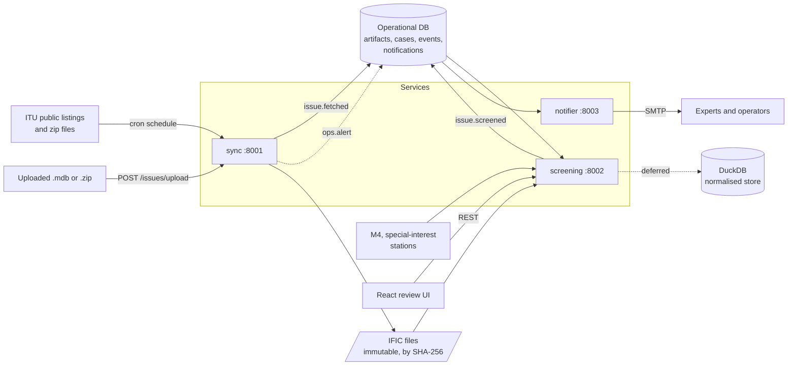

# IFIC Guard: services architecture

How IFIC Guard runs as FastAPI services: keeping IFIC databases up to date, screening each new issue, and emailing experts. This builds on [ARCHITECTURE.md](../ARCHITECTURE.md), which defines the analysis itself (adapters, relevance filter, pfd and P.1546 engines, LLM layer). This document covers how that analysis gets its data, runs, and reaches people.

## 1. Decisions

| Decision | Choice | Why |
|---|---|---|
| Service split | Three services in one repo and one Python package: `sync`, `screening`, `notifier` | They fail and scale differently, but a small team can still change them together |
| How issues arrive | Downloaded from ITU on a cron schedule, or uploaded as an `.mdb` or a `.zip` containing one | Both take the same path afterwards, so screening cannot tell them apart |
| Terrestrial neighbours | Russia, Sweden, Estonia, Norway, Denmark (`RUS`, `S`, `EST`, `NOR`, `DNK`) | Set by the team, and configurable with `IFIC_NEIGHBOUR_ADMS`. Space filings are not limited to these, because a satellite from anywhere can reach Finland |
| Messaging | Outbox table in the operational database | No broker to run. An event commits together with the change it announces, so neither is lost |
| Operational data | Postgres (SQLite for local development) | Several processes must write at once |
| Analytical data | **Deferred.** Designed as DuckDB as in `schema.sql`, written only by `screening`; rules read the `.mdb` directly for now | DuckDB allows one writing process, so it cannot be the shared store |
| What triggers email | Deterministic rules only | Principle 1 in ARCHITECTURE.md: the LLM never decides relevance |
| Email unit | One digest per issue, not one mail per case | IFIC 3083 alone produces 39 cases |
| Wording | "Possible concern", never "violation" | Screening flags cases. Whether a filing breaks a limit takes the pfd engine and an expert |

**Case and finding.** A *finding* (ARCHITECTURE.md section 5) is the result for one frequency assignment. A *case* is what a person reviews: one rule against one notice family, holding its evidence and review status. A modification and the notice it modifies share a family, so they produce one case.

## 2. System overview



## 3. Services

| | `sync` | `screening` | `notifier` |
|---|---|---|---|
| Job | Find and store new issues | Turn issues into cases; serve review | Email experts and operators |
| Consumes | ITU listings on a cron schedule, uploaded files | `issue.fetched` | `issue.screened`, `ops.alert` |
| Publishes | `issue.fetched`, `ops.alert` | `issue.screened` | Nothing |
| Writes | `artifact`, `sync_run`, IFIC files | `case_`, DuckDB, `artifact.screen_status` | `notification` |
| Read API | `GET /issues`, `/runs`, `/status` | `GET /cases`, `/cases/{id}` | `GET /notifications` |
| Write API (needs key) | `POST /sync`, `POST /issues/upload` | `PATCH /cases/{id}`, `POST /issues/{id}/screen` | `POST /notifications/test` |

Every service also serves `/health`, `/ready` and FastAPI's `/docs`. Each runs as one uvicorn process with its background loops in the app lifespan. **Run one replica of each for now.** The outbox is safe with more, but the sync scheduler's lock is per process.

### Events

Each topic has one consuming service. Delivery is at-least-once, so handlers must be idempotent.

| Topic | Payload | Consumer's idempotency |
|---|---|---|
| `issue.fetched` | `artifact_id` | Cases are upserted by fingerprint |
| `issue.screened` | `artifact_id`, `status`, `opened`, `changed` | Digest `dedupe_key` |
| `ops.alert` | `dedupe_key`, `subject`, `body` | `dedupe_key` |

A worker claims an event with a compare-and-set update and holds a 30-minute lease, so a crashed worker's event is retried. Failures back off exponentially. After 5 attempts an event is marked `dead` and raises an `ops.alert`.

## 4. Sync subsystem

Findings from ITU's live pages on 2026-11-07:

| | Space | Terrestrial |
|---|---|---|
| Listing | `sns/wic/demowic{YY}.html`, one page per year | `en/ITU-R/terrestrial/brific/Pages/default.aspx`, last 10 issues |
| File | `sns/ific10/ific{N}.zip`; the `ific10` part is the data version, so it is read from the page | `.../BRIFIC/MDB/brific{N}.zip` |
| Contents, issue 3083 | One `.mdb`, 19 MB zip, 118 MB database | One `.mdb`, 3.4 MB zip, 33 MB database, different schema |
| Login | None seen | None seen |

Issues appear about every two weeks. Issue 3084's files return 404 for now, which gives a clean "not published yet" signal.

**One pass:**

1. Read each domain's listing. Keep issues at or above `IFIC_MIN_ISSUE`.
2. Fetch any issue not stored yet, oldest first, so diffs run in publication order.
3. Send `HEAD` for the newest issue. A changed ETag means ITU republished it, and the file is stored as a new revision.
4. Verify: byte count, size limits, zip CRC, exactly one database, Access file header.
5. Move it atomically to `data/ific/<domain>/<issue>/<sha12>/`. Files are never overwritten.
6. Commit the `artifact` row and `issue.fetched` together.

**Schedule.** `IFIC_SYNC_CRON` takes a standard cron expression, in UTC. The default, `0 */6 * * *`, runs every 6 hours. The `sync` service runs it in-process, so containers need no system cron. A brand new install syncs at once rather than waiting for the first slot. To use a system crontab instead, call `python -m ific_guard.cli sync`, and do not run the `sync` service's schedule alongside it.

**Upload.** `POST /issues/upload` takes a multipart `file`, either an `.mdb` or `.accdb`, or a `.zip` containing exactly one. ITU-style names identify it (`ific3074` is space, `brific3076` is terrestrial). For any other name, send `domain` and `issue_no` as form fields. The same exact file uploaded twice is stored and screened once, and an uploaded issue is not downloaded again.

```bash
curl -H "X-API-Key: $IFIC_API_KEY" -F file=@ific3074.zip localhost:8001/issues/upload
```

The hash is taken from the file as supplied, so the same issue given as an `.mdb` and as a `.zip` counts as two revisions. Cases are not duplicated if that happens, because they are matched by fingerprint.

**Failing visibly matters most here,** because a broken sync otherwise looks the same as "no new issue":

| Situation | Behaviour |
|---|---|
| Listing loads but no issues can be read (page redesign) | Raises `ListingChanged`; the run is marked failed and ops is alerted |
| One domain is down | The other still syncs; the run is `partial` |
| Any errors in a run | Retry after 15 minutes rather than waiting for the next slot; at most one sync alert per day |
| No issue for over 21 days (normal gap is 14-17) | `GET /status` reports `stale: true`. It does not raise an alert yet |
| Corrupt, truncated or oversized file | Rejected before anything becomes visible |
| Download link outside `itu.int` | Refused |

**Use of ITU's service.** The space page describes this as a free service "on a trial basis until further notice". Polling every 6 hours for files published every two weeks is light. Read ITU's Terms of Use before any use beyond the hackathon, and do not redistribute the files; `files/` and `data/` are git-ignored.

## 5. Screening

A rule takes a parsed issue and returns hits:

```python
class Rule(Protocol):
    id: str
    def run(self, issue: SpaceIssue) -> Iterable[Hit]: ...
```

New checks plug in here, including the pfd engine and special-interest station overlap.

| Rule | Fires when | Severity |
|---|---|---|
| `fin-named-by-br` | Tier 1: `FIN` appears in `provn` or `tr_provn` for an in-scope notice | High |
| `m4-no-space-to-earth` | A visible satellite transmits in a band with Finnish terrestrial or passive use and no space-to-Earth allocation in `data/national/m4_bands.csv` (built by `tools/build_m4_bands.py`) | Medium; high for a passive band |
| `terrestrial-p1546` | A land-mobile notice from a configured neighbour passes the distance screen and has calculable inputs | High above a T/R 25-08 threshold; medium with no criterion, or where the notifier declares FIN coordination completed, or with data-quality items; low below it |
| `terrestrial-not-calculated` | The same notice lacks an input the calculation needs | Medium: never a clear result |

- **Scope:** API/A and CR/C notices, with suppressions skipped.
- **Visibility:** GSO from 47°W to 97°E. Non-GSO reaching at least 55° latitude. Missing orbit data keeps the notice in, following the conservative principle.
- **Re-flagging:** the same content in a later issue updates `last_issue` and stays silent. Changed content reopens the case for review and notifies again.
- **Comment deadline:** IFIC date plus 4 months. It is an estimate, and the email says so.

**Severities are placeholders** until the ranking in ARCHITECTURE.md section 4.7 replaces them.

## 6. Notifications

`notifier` works in two steps, so an SMTP outage never blocks event processing: an event creates a `notification` row, and a separate loop sends what is due.

- **Experts:** one digest per issue, ranked, filtered by `IFIC_NOTIFY_MIN_SEVERITY`, showing notice IDs, deadline, review link, source URL and file SHA-256. No new cases means no email.
- **Operators:** sync failures and dead events.
- **Backends:** `console` (default), `file` and `smtp`. Real mail needs an explicit setting.
- **Retries:** exponential backoff, 6 attempts, then `failed` and visible in `GET /notifications`.
- **Known limit:** a crash between sending and recording can send a duplicate. That is better than losing an alert.

## 7. Security

- Write endpoints require `X-API-Key`, and stay closed if no key is set.
- Compose binds ports to localhost. A shared key is not enough for public exposure: production needs SSO and per-reviewer identity, so that review decisions can be attributed.
- ITU files are untrusted. Zip paths are reduced to a base name and extracted bytes are capped.
- Secrets come from the environment only.

## 8. Running it

```bash
uv sync
cp .env.example .env                 # then set IFIC_API_KEY
uv run python -m ific_guard.cli init-db

uv run uvicorn ific_guard.sync.app:app --port 8001
uv run uvicorn ific_guard.screening.app:app --port 8002
uv run uvicorn ific_guard.notifier.app:app --port 8003

uv run pytest
```

To skip a download, load a local copy with `uv run python -m ific_guard.cli import files/ific3083.zip`, or upload it (section 4). Full stack: `docker compose up --build`.

With the default `IFIC_MIN_ISSUE=3074`, the first sync downloads about 20 zips. The space ones are 20-60 MB each.

## 9. Current status

### Historical issue support observed on 2026-11-07

| Sample / range | How obtained | Observed format/version | Screens? |
|---|---|---|---|
| 3074-3083 (2026) | `sns/wic/demowic26.html` → `sns/ific10/ific{N}.zip` | Space SNS, version 10 | Yes; all ten screened in the clean run of 2026-11-07 (3074: 182 cases) |
| 2925 (2020) | `sns/wic/demowic20.html` → `sns/ific8/ific2925.zip` | Space SNS, version 8 | No; clearly rejected as unsupported |
| 2809 (2015) | `sns/wic/demowic15.html` → `sns/ific61/ific2809.zip` | Space SNS, version 7 | No; clearly rejected as unsupported |
| 2559 (2005) | `sns/wic/demowic05.html` → `sns/ific5/ific2559.zip` | Space SNS, version 5 | No; clearly rejected as unsupported |
| 2010 and 1998 pages | Yearly URLs returned HTTP 200 but no rows matching the current parser | Format/version not verified | No sample obtained |
| Terrestrial 2800 and 3000 | `.../BRIFIC/MDB/brific{N}.zip` | ZIPs reachable; no `srs_ooak` table (space versioning does not apply) | Terrestrial adapter scope, not this space reader |
| Terrestrial 2500 and 2200 | Same known URL pattern | HTTP 404 | No sample obtained |

Space discovery walks back to 1998. A 404 or an unreadable historical page is
logged and skipped, but a failure on the current year's page is surfaced. Space
screening reads `srs_ooak.version_no` before interpreting the database. The
version is retained in each case's evidence as `database_version`; a missing or
unsupported value fails screening rather than producing an empty result.

Per-issue evidence is now retained in the additive `case_occurrence` table.
Each row links an artifact to its cross-issue review case and stores the exact
hit from that artifact's latest successful screening. Re-screening replaces
only that artifact's occurrences, atomically with case updates. Run
`python -m ific_guard.cli init-db` on existing installations to create the table,
then re-screen imported artifacts to backfill it. Exports continue evaluating
the selected source directly without changing review state or notifications.
Processing-order tests cover 3074 alone, before 3083 and after 3083; the 3074
CSV/JSON stays identical.

**Verified**

- Automated tests pass, using fake servers and no real mail.
- All three services as separate processes on SQLite, against live ITU: both 3083 files fetched in 45 s, 39 cases opened (9 high, 30 medium), one digest written to a file, in 64 s overall. The downloaded space zip's SHA-256 matches `files/ific3083.zip`.
- On Postgres through Compose, against live ITU: sync run `ok`, the same 39 cases as SQLite, one digest written to a file. Re-screening the issue added no cases and no email.
- Uploads with the real files, on SQLite: `brific3076.mdb` and `ific3074.zip` were accepted, a repeat upload was recognised, and a request with no key got 401. Space 3074 screened in under a minute at about 700 MB peak memory.
- Cron, on SQLite with an every-minute schedule: runs started on the minute with no errors.
- Discovery finds Space and Terrestrial 3074-3083 with `IFIC_MIN_ISSUE=3074`, and downloading Space 3074 and Terrestrial 3076 directly gave the same hashes as the shared copies.

- **Clean Compose run on Postgres, 2026-11-07, at commit ba6f09a:** from empty volumes, the first scheduled sync finished `ok` with 20 of 20 issues (Space and Terrestrial 3074-3083) fetched in about 3 minutes, all 20 reached `done` in about 8 minutes, and 20 digests were written to files. No real mail was sent.
- **Upload on Postgres:** a second empty database given `ific3074.zip`, `brific3075.mdb` and `brific3076.mdb` produced the same cases. The only differences were the source URL and the hash and size of the uploaded file. A request with no key got 401, and repeat uploads were recognised.
- **Demo rehearsal from a clean start:** see `docs/demo.md`. Drafts returned 200 for all 224 cases in 3083, and screening the issue again added no cases or notifications.
- **Hand check:** see `outputs/hand-check.md`. All 21 P.1546 values match upstream code in Octave to within 0.006 dB (`tools/crosscheck_p1546_octave.py`).
- The Python suite passes, with 554 tests including those reading real issues, and the frontend's 32 tests pass.

**Open or not yet verified**

| Item | Detail |
|---|---|
| **One unexplained download failure under Compose** | One of two runs ended `partial` with `could not fetch space issue 3083`; the error text was lost, and the next run was clean. It may have been a network problem, but that is unconfirmed. The failure alert fired and the other domain still synced. If it recurs, read `errors` from `GET localhost:8001/runs` |
| Real SMTP | Tested with a mocked client only |
| Clean-run faults, now fixed | The first full run found every terrestrial issue failing in the container (mask path) and Space 3077 lost to invalid date cells. The rehearsal found drafts crashing on pfd cases, and calling upper bounds exceedances. Each has a test |
| Case rechecks | `outputs/hand-check.md` samples each rule from raw rows |
| Case accuracy | No case has been checked by an expert or compared with Traficom's results |

**Known gaps**

| Gap | Effect | Fix |
|---|---|---|
| Terrestrial criteria are partial | Land-mobile notices get a P.1546 field strength against the T/R 25-08 Annex 1 indicative threshold. Above 470 MHz the 400-470 MHz value is applied as Traficom said (ticket 20). The values are unconfirmed on the Russian border, and Annexes 3 and 4 aren't used | Traficom's answers on Q6, Q8 and Q9 (ticket 02) |
| Cases span issues | A case seen in two issues counts once, so a digest or count for one issue can omit it. **Export per issue, not from "new" cases** | Ticket 03 |
| Older issues reject | Only Space database version 10 screens. Versions 8, 7 and 5 are rejected with a clear error, not read | The brief asks for all existing issues | Add readers for each version |
| Worst-case gain | pfd results apply maximum notified gain towards Finland, as Traficom said to assume, and frequency rules over-flag. `s_beam` has no boresight in 3074 | None planned: Traficom said beams "are not relevant" |
| AP30, AP30A, AP30B not screened | The brief puts them in scope; issue 3083's plan tables are empty, so this is untested | Add notice handling using an issue that contains them |
| DuckDB store deferred | Rules read the `.mdb` directly, which has been fast enough one issue at a time | Load `schema.sql` tables inside `screening` when cross-issue analysis needs it |
| Tables made with `create_all` | Schema changes need manual work | Alembic |
| Filings around the Moon | Six networks in 3074 get M4 and station cases as if they were Earth satellites; pfd sets them aside | Apply `ref_body` in the visibility screen |
| `access-parser` is a young library | Parsing errors could go unnoticed | Compare row counts against `mdbtools` on 3074 and 3076 |

## 10. Next steps, in order

The full breakdown is in `.scratch/ific-guard-delivery/map.md`.

1. Process Space 3074, which is evaluated separately, and export its cases.
2. Add a special-interest station overlap rule.
3. Add the pfd engine as a rule, which is what allows a case to say a limit is exceeded.
4. Add the terrestrial land-mobile adapter, the diff between issues, and P.1546 for Terrestrial 3076.
5. Add LLM explanations and draft letters to the case detail. The review UI in `frontend/` already uses the services.

After the hackathon: Alembic, SSO, staleness alerts, a stuck-event view and metrics.

## 11. Questions for Traficom

Added to ARCHITECTURE.md section 9:

1. Who should receive the email, and would they want a digest or also immediate alerts for high-severity cases?
2. Would ITU's terms allow automated downloads and retention of these files in production?
3. Is the 4-month comment window right for every section in scope, including API/A?
4. Do you provide a template for the 3074 and 3076 results? The brief says "separate file(s) to be provided".
5. Terrestrial 3075, 3076 and 3083 hold fixed and mobile notices from Russia and Estonia only among the five neighbours. Is coordination data (`fxm_coord`), which also names Sweden and Norway, what matters for those countries?
